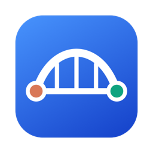
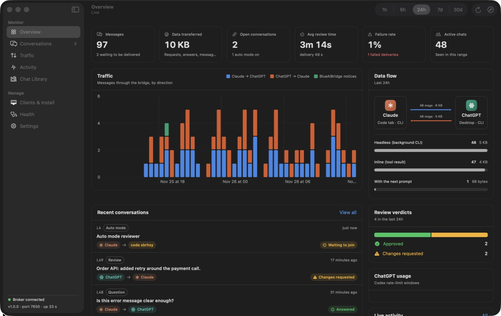
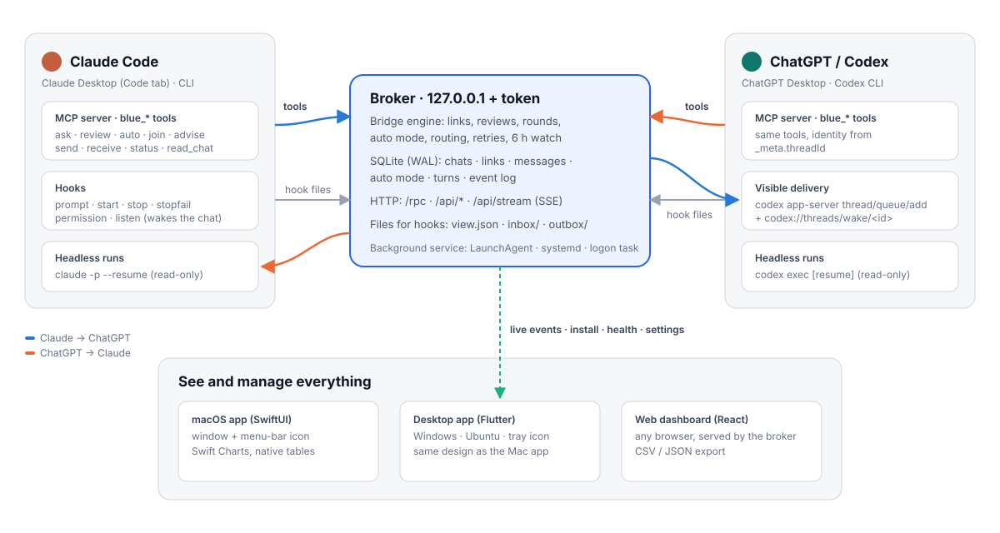
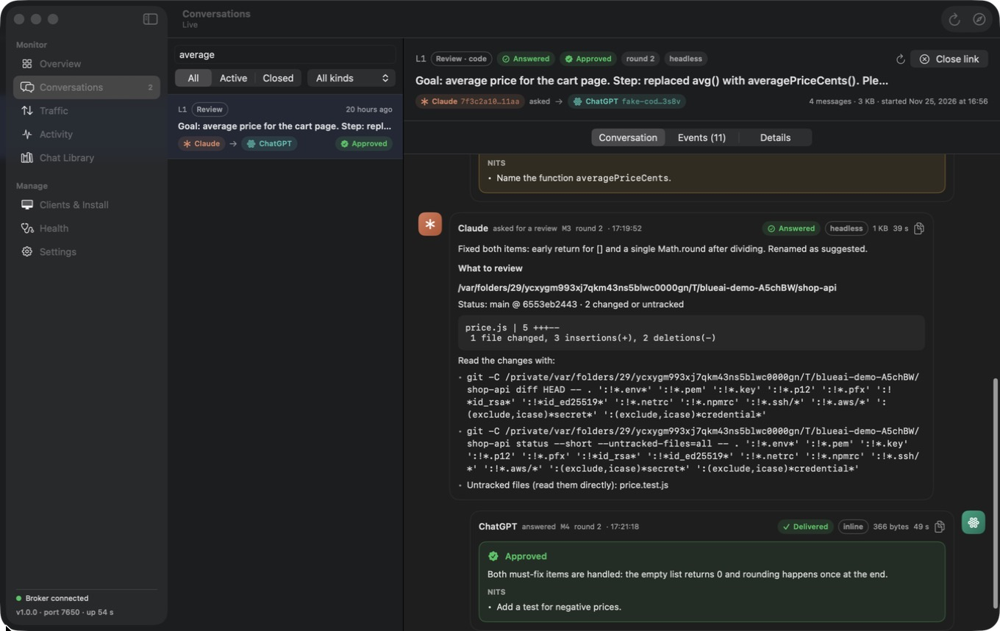
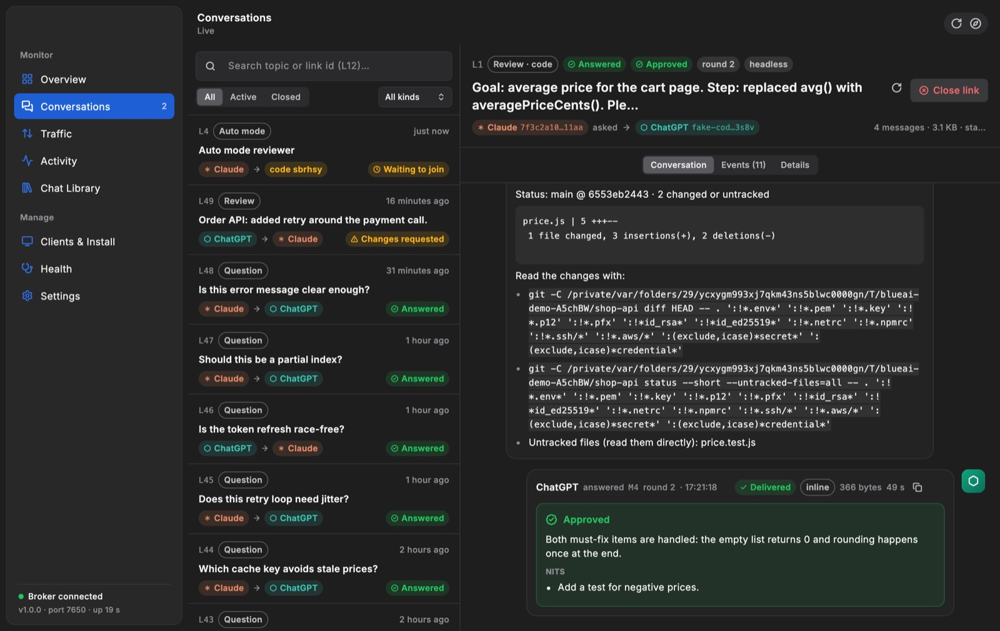
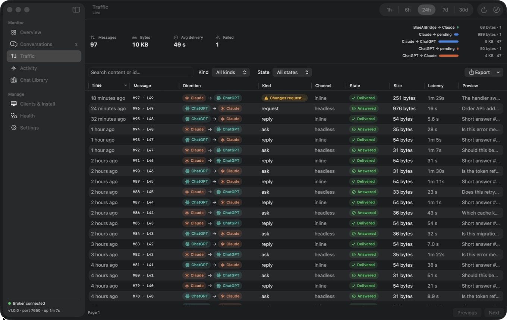
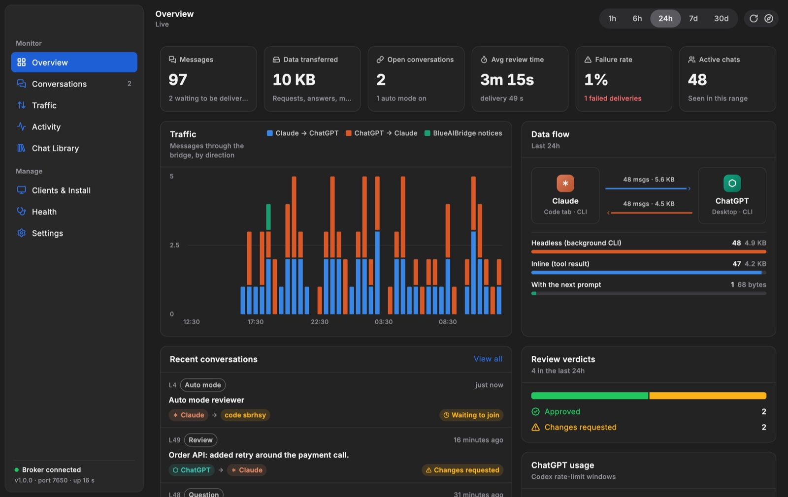

<p align="center">
  
</p>

<h1 align="center">BlueAIBridge</h1>

<p align="center">
  <b>Claude Code and ChatGPT review and talk to each other, with your own subscriptions and no API keys.</b><br>
  A native macOS app (Swift), a desktop app for Windows and Linux (Flutter) and a web dashboard let you watch every exchange.
</p>

<p align="center">
  <a href="../../actions/workflows/build.yml"></a>
  <a href="../../releases/latest"></a>
  
  
</p>

> [!WARNING]
> **BlueAIBridge is under heavy development.** The apps and the bridge may be unstable, and features, settings and file formats can change between releases without notice. Use it at your own risk, and keep your work in git so you can undo anything an agent changes.

<p align="center">
  
</p>

- From **Claude Code**: *"Ask ChatGPT to review this change"*, *"Get the plan reviewed by ChatGPT"*, *"Work with GPT on this"* (auto mode).
- From **ChatGPT** (Codex chats): *"Ask Claude for a second opinion"*, *"Have Claude review my diff"*, *"Work with Claude on this"*.
- Watch it all in the **UI**: conversations side by side, every message's direction, size, latency and outcome, live activity, the health of every piece, and one-click install and uninstall.

## Download

| | Get it | Notes |
|---|---|---|
| **macOS** (Apple silicon) | `BlueAIBridge-<version>-macos-arm64.zip` | Unzip into `~/Applications`. The app isn't notarized yet; see [Run the macOS app](#run-the-macos-app). |
| **Windows** (x64) | `BlueAIBridge-<version>-windows-x64-setup.exe` or `.zip` | The setup can start BlueAIBridge in the tray when you sign in. |
| **Ubuntu / Debian** | `blueaibridge_<version>_amd64.deb` or `_arm64.deb` | `sudo apt install ./blueaibridge_<version>_amd64.deb`. Also as `.tar.gz`. |
| **The bridge** (all systems) | `BlueAIBridge-<version>-bridge.tar.gz` | Needs Node.js 22.5+. Unpack it, then run `node dist/src/cli.js install`. |

All of these are on the [latest release](../../releases/latest). The apps show and manage the bridge, which you install once per computer (see [Install](#install)).

## Run the macOS app

Needs macOS 14 or later on Apple silicon, and Node.js 22.5+ (`brew install node`).

1. Install the bridge. From the [latest release](../../releases/latest), download `BlueAIBridge-<version>-bridge.tar.gz`, then:

   ```bash
   tar -xzf ~/Downloads/BlueAIBridge-*-bridge.tar.gz -C ~
   cd ~/BlueAIBridge && node dist/src/cli.js install
   ```

2. Install the app. Download `BlueAIBridge-<version>-macos-arm64.zip` from the same release and unzip it into `~/Applications`:

   ```bash
   mkdir -p ~/Applications && unzip -o ~/Downloads/BlueAIBridge-*-macos-arm64.zip -d ~/Applications
   ```

3. Let macOS open it. The app isn't notarized yet, so macOS blocks it the first time. Either remove the download quarantine:

   ```bash
   xattr -dr com.apple.quarantine ~/Applications/BlueAIBridge.app
   ```

   or open it once, then go to **System Settings → Privacy & Security** and click **Open Anyway**.

4. Open it from `~/Applications`, Spotlight, or with `node dist/src/cli.js ui`. It lives in the menu bar; closing the window keeps it running there.

5. Restart Claude Desktop and ChatGPT Desktop, trust the BlueAIBridge hooks when ChatGPT asks, and check everything with `node dist/src/cli.js doctor`.

To build the app from source instead, see [Install](#install) (`npm run build:mac`, needs Xcode).

## How it works

<p align="center">
  
</p>

Each app runs the same MCP server, so its chats get the `blue_*` tools, and a set of hooks. Both connect to one local **broker**, which:

- keeps every link, message and verdict in SQLite;
- delivers a message **visibly**, into the other app's open chat, or **headless**, through a background run of that app's CLI that returns the answer;
- streams every event live to the apps.

More detail is in [docs/ARCHITECTURE.md](docs/ARCHITECTURE.md).

## Screenshots

| macOS (SwiftUI) | Windows / Linux (Flutter) |
|---|---|
|  |  |
|  |  |

## Clients

| Client | How it connects |
|---|---|
| Claude Desktop (Code tab) | MCP server (user scope) + hooks in `~/.claude/settings.json` |
| Claude Code CLI | same config as Claude Desktop |
| ChatGPT Desktop | MCP server in `~/.codex/config.toml` + hooks in `~/.codex/hooks.json` |
| Codex CLI | same config as ChatGPT Desktop |

## Install

Requirements: Node.js 22.5+, git, and the apps you want to connect (signed in).

| | macOS | Windows | Linux |
|---|---|---|---|
| Clients | Claude Desktop, Claude Code CLI, ChatGPT Desktop, Codex CLI | Claude Desktop, Claude Code CLI, ChatGPT Desktop, Codex CLI | Claude Code CLI, Codex CLI |
| UI | native Swift app + web | Flutter desktop app + web | Flutter desktop app + web |
| Background service | LaunchAgent | logon task (Task Scheduler) | systemd user service |
| Delivery | visible + headless | visible + headless | headless (no desktop apps on Linux) |

**macOS**

```bash
npm install
npm run build
npm run build:mac
node dist/src/cli.js install
```

`build:mac` needs Xcode's Swift toolchain. The app targets macOS 14+.

**Windows** (PowerShell) and **Linux**

```bash
npm install
npm run build
node dist/src/cli.js install
```

Then install the desktop app: the `.deb` (Ubuntu) or `setup.exe` (Windows) from the latest [GitHub release](../../releases), or build it yourself (see [desktop/README.md](desktop/README.md)) and run `node dist/src/cli.js install desktop`.

Then restart Claude Desktop and ChatGPT Desktop. ChatGPT asks you to trust the BlueAIBridge hooks once; it skips new hooks until you do. Check everything:

```bash
node dist/src/cli.js doctor
```

Open the UI. On macOS this opens the native app; on Windows and Linux, or with `--web`, it opens the browser:

```bash
node dist/src/cli.js ui
```

`install` copies the built app to `~/.blueaibridge/runtime/current` and points every client there, so this folder can move afterwards. Every config file it touches is backed up to `~/.blueaibridge/backups/<time>/` first, and your own settings and hooks are kept. To remove it all:

```bash
node dist/src/cli.js uninstall
```

You can install or remove one piece at a time: `runtime`, `claude`, `codex`, `service`, `menubar` (the macOS app), `desktop` (the Windows/Linux app). The UI's **Clients & Install** page does the same with buttons.

To install on another machine, copy this folder (without `node_modules` and `dist`) and run the commands for that OS.

> Windows and Linux are implemented and covered by installer tests, but they haven't been run on a real Windows or Linux machine yet.

## What it does

| Feature | |
|---|---|
| **Ask** (`blue_ask`) | One question to the other AI, answered in this chat. The other agent reads your files (read-only). Follow-ups continue the same conversation with `session_id`. |
| **Review** (`blue_review`) | Code or plan review. The answer is always `[APPROVED]` or `[CHANGES REQUESTED]` with must-fix items and nits. The reviewer reads the changes itself through ready git commands, so diffs aren't pasted unless you want them. |
| **Fix loop** | After changes are requested, the agent fixes what holds up, pushes back where a finding is wrong, and asks again with `round_of`. The same reviewer remembers the last round. An emergency stop ends the loop after 20 rounds (configurable). |
| **Plan reviews** | The reviewer's approval is not yours: the agent shows you the plan and the verdict and waits for your go-ahead. |
| **Auto mode** (`blue_auto`) | One reviewer chat for a whole piece of work. **Key moments**: the agent asks at the moments that matter, and an end-of-turn check stops a turn once if changes aren't approved. **Every turn**: each turn goes to the reviewer automatically; only `[CHANGES REQUESTED]` interrupts. |
| **Join codes** (`blue_join`) | Any chat (including another chat of the same app) becomes the reviewer by pasting a 6-character code. |
| **Messages** (`blue_send`, `blue_receive`) | Free messages between the two chats between reviews. |
| **Read chats** (`blue_read_chat`) | Read a chat of the other app stored on this Mac, by name or id, even with the app closed. Chats that are reviewing for someone are protected. |
| **Status / unlink** | Open links, health of the other side, ChatGPT usage limits; close links cleanly. |
| **Your rules** | `~/.blueaibridge/rules.md` reaches every linked chat from your own file, never through the other agent. |

### Two ways to deliver

- **Visible**: the message appears in the other app's chat. ChatGPT: queued in the thread through the app's bundled `codex app-server`, then woken with `codex://threads/wake/<id>`. Claude: a background hook (`asyncRewake`) wakes the session.
- **Headless**: the other app's CLI runs in the background (`codex exec` / `claude -p`) and the answer comes back to the asking chat. This needs neither app open, and it is the fallback when visible delivery isn't possible.

`delivery` in Settings picks the default (auto, visible or headless). Each call can override it.

### Reliability

- Closed apps: the agent asks you before opening ChatGPT or a Claude session (or always opens them if you say so). Messages for a closed Claude session wait and arrive when it opens.
- Usage limits: a message waits until ChatGPT's limit resets, and the asking chat is told when that will be.
- Failures retry with backoff. A reviewer turn that ends without an answer is noticed. A verdict written as prose instead of through the tool is still accepted. API errors (`StopFailure`) and tool-approval prompts are reported to the waiting chat.
- The other agent can never call back into the bridge from a run the bridge started.

## The UI (Swift on macOS, Flutter on Windows/Linux, web everywhere)

Both have the same pages, data and actions:

| Page | |
|---|---|
| Overview | KPIs (messages, data, open conversations, review time, failure rate, active chats), traffic by direction, data flow, verdicts, ChatGPT usage, live activity |
| Conversations | Every link as a thread: requests, verdicts with must-fix items, notices, per-message state, channel, size and latency; events; close and retry |
| Traffic | Every message with filters and search, plus breakdowns by direction and channel; CSV/JSON export |
| Activity | The live event stream, with filters and pause |
| Chat library | Read any local Claude Code session or ChatGPT thread |
| Clients & install | Detected clients, install/uninstall per target, every chat seen by the bridge |
| Health | Live checks with a fix for each problem (`blueai doctor`) |
| Settings | Behaviour, models, limits, retention, and your rules |

It has light and dark themes, a ⌘K command palette, and live updates over Server-Sent Events.

## Security

- The broker listens on `127.0.0.1` only and requires a 256-bit token. Host-header checks guard against DNS rebinding, cross-origin writes are refused, and a strict CSP applies. The dashboard uses an HttpOnly, SameSite=Strict cookie.
- Messages from the other agent are framed as peer input that can't authorize anything. Your rules come only from your own file.
- Files whose names suggest secrets (`.env*`, keys, certificates, `*secret*`, `*credential*`, `.ssh/`, `.aws/`…) are left out of listings, diffs, fingerprints and the reviewer's commands.
- Headless reviewers run read-only (`read-only` sandbox; Claude without edit tools).
- **Your code and questions go to the other vendor** whenever one agent asks the other.

See [docs/ARCHITECTURE.md](docs/ARCHITECTURE.md) for how it works and [docs/FEATURES.md](docs/FEATURES.md) for the comparison with agent-review-bridge.

## Development

```bash
npm test
```

```bash
npm run typecheck
```

```bash
node scripts/demo.mjs 7650
```

`npm test` runs 41 tests over real processes, git repos and temp configs, with fake agent CLIs. `scripts/demo.mjs` starts a throwaway broker seeded with sample traffic for dashboard work. Run `npm run dev:ui` for the dashboard with hot reload, against a running broker.

### Releases

CI ([.github/workflows/build.yml](.github/workflows/build.yml)) runs on every push:

- the bridge's tests and typecheck;
- the macOS app (SwiftUI) build;
- the Linux desktop app: analyze, test, then `.deb` and `.tar.gz`;
- the Windows desktop app: `setup.exe` (Inno Setup) and `.zip`.

Pushing a version tag publishes all of them as a GitHub release:

```bash
git tag v1.0.1 && git push origin v1.0.1
```

